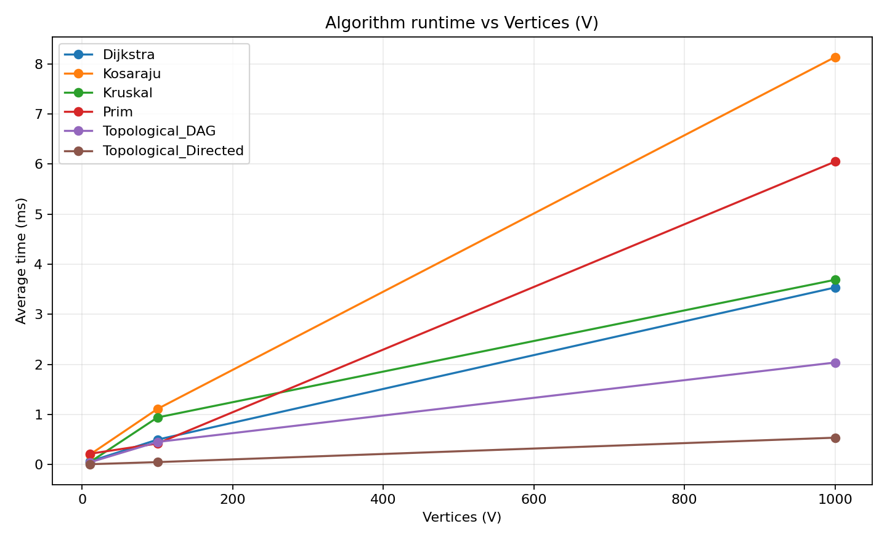
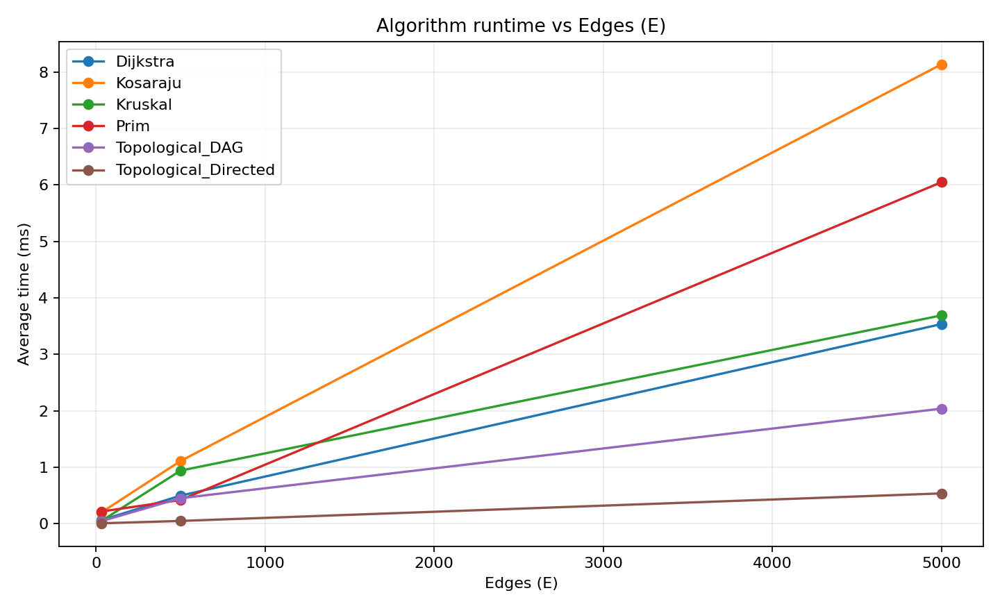

# Assignment 3 — Smart City Infrastructure and Route Planning

## Overview
This Java 17 application models a smart city as a **weighted graph**, where vertices represent districts, edges represent roads or infrastructure links, and edge weights represent costs or distances. **Undirected graphs** model two-way connections for minimum spanning trees; **directed graphs** model one-way connections or dependencies for topological ordering and strongly connected components. Dijkstra's algorithm computes shortest nonnegative-weight paths.

## Implementation

- `graph/Graph.java` stores an adjacency list and one original edge per insertion. Undirected edges are stored in both directions in adjacency lists, but once in the primary edge list.
- `dsu/DSU.java` implements union by rank and find with path compression.
- `mst/Kruskal.java` sorts all edges by weight and uses DSU to reject cycles. `mst/Prim.java` grows an MST (or forest for disconnected input) using a min-priority queue.
- `connectivity/TopologicalSort.java` uses Kahn's algorithm and detects a cycle if fewer than V vertices are emitted. `connectivity/Kosaraju.java` uses a two-pass iterative DFS and reversed adjacency lists.
- `shortestpath/Dijkstra.java` uses a min-priority queue, tracks predecessors, reports distances and reconstructed paths, returns an empty path for unreachable vertices, and rejects negative weights.
- `experiment/GraphGenerator.java` uses a fixed seed, unique directed or undirected edges, and strictly positive random weights in the range 1–100.

Run `com.smartcity.Main` to see an example city network, MST results, shortest paths, SCCs and cycle detection.

## Complexity Analysis

The following bounds assume an **adjacency list**, a **binary min-heap** for Prim and Dijkstra, **comparison sorting** for Kruskal, and an optimized DSU. V is vertices and E is edges.

| Algorithm | Time complexity | Extra space | Explanation |
|---|---|---|---|
| DSU `find` / `union` | Amortized O(α(V)) | O(V) | Path compression and rank balancing keep trees very shallow; α is the inverse Ackermann function. |
| Kruskal | O(E log E + E α(V)) | O(V + E) | Sorting dominates; union/find is nearly constant amortized. |
| Prim | O((V + E) log (V + E)) | O(V + E) | Adjacency list and lazy binary heap can contain multiple candidate edges. |
| Kosaraju SCC | O(V + E) | O(V + E) | Two DFS passes plus transpose construction. |
| Topological ordering | O(V + E) | O(V) | Kahn's algorithm computes indegrees then processes each edge once. |
| Dijkstra | O((V + E) log (V + E)) | O(V + E) | Nonnegative edges; lazy binary heap holds candidates. |

With increasing V, vertex initialization and bookkeeping become more expensive. With increasing E, MST sorting and priority-queue operations are more expensive, while SCC and topological ordering remain linear in graph size. Dijkstra is **not valid for negative edge weights** because its greedy shortest-distance finalization reasoning depends on nonnegative relaxations; Bellman–Ford is a suitable alternative if negative weights must be supported.

## Experimental Setup

| Configuration | Vertices (V) | Edges (E) |
|---|---:|---:|
| Small | 10 | 30 |
| Medium | 100 | 500 |
| Large | 1,000 | 5,000 |

Each algorithm is measured **5 times** using `System.nanoTime()`, with three warm-up runs beforehand. The tables report the arithmetic mean of the five measured runs. Every run operates on a pre-generated input graph (graph-generation time is excluded from timings). All datasets use fixed RNG seeds derived from the graph size, so graph structure and weights are reproducible. The exact timings still vary with JVM, hardware, JIT compilation, operating system, and scheduling.

**Generation methods:** Undirected MST graphs are connected by first adding a random spanning tree; the generator then adds unique random edges to reach E. Directed DAGs have all edges pointing from a lower-numbered vertex to a higher-numbered vertex, ensuring acyclicity. Directed cyclic input starts with a guaranteed two-vertex cycle `0 → 1 → 0`, and then adds random directed edges. The requested E is the number of unique edges, no self-loops, weights 1–100. SCC and cyclic topological runs share the cyclic dataset. Dijkstra uses the same connected undirected dataset as MST with source vertex 0.

**Operation counting:** Counts are algorithm-specific, not a standardized CPU instruction count. Kruskal counts sorting comparisons, inspected edges, and DSU operations; Prim counts heap comparisons and examined adjacency/heap edges; Kosaraju counts visited/reversed edges and visited vertices; topological ordering counts indegree/edge examination and processed vertices; Dijkstra counts heap removals and relaxations. Consequently, operation counts should be compared **primarily across input sizes within one algorithm**, not as an absolute comparison between different algorithms.

## Results

Actual measured results from a Java 21 runtime executing Java 17-compatible source code in the project's development environment (one run; hardware-specific). To reproduce on your machine, run the benchmark yourself and regenerate the plots.

| Algorithm | V | E | Mean time (ms) | Mean operations |
|---|---:|---:|---:|---:|
| Kruskal | 10 | 30 | 0.0447 | 160 |
| Prim | 10 | 30 | 0.2143 | 290 |
| Kosaraju | 10 | 30 | 0.1954 | 100 |
| Topological_DAG | 10 | 30 | 0.0427 | 70 |
| Topological_Directed | 10 | 30 | 0.0060 | 30 |
| Dijkstra | 10 | 30 | 0.0599 | 78 |
| Kruskal | 100 | 500 | 0.9394 | 5247 |
| Prim | 100 | 500 | 0.4191 | 9235 |
| Kosaraju | 100 | 500 | 1.1097 | 1600 |
| Topological_DAG | 100 | 500 | 0.4507 | 1100 |
| Topological_Directed | 100 | 500 | 0.0482 | 511 |
| Dijkstra | 100 | 500 | 0.4969 | 1201 |
| Kruskal | 1000 | 5000 | 3.6891 | 68522 |
| Prim | 1000 | 5000 | 6.0488 | 125936 |
| Kosaraju | 1000 | 5000 | 8.1364 | 16000 |
| Topological_DAG | 1000 | 5000 | 2.0373 | 11000 |
| Topological_Directed | 1000 | 5000 | 0.5359 | 5037 |
| Dijkstra | 1000 | 5000 | 3.5355 | 11921 |


### Plot 1 — Execution time vs number of vertices



### Plot 2 — Execution time vs number of edges



Raw data: [`results/tables/benchmarks.csv`](results/tables/benchmarks.csv). Since the specified experiment sizes increase **both V and E together**, these two plots show the same experimental cases with different x-axis labels; they do **not** isolate the independent causal impact of vertices vs edges. Additional fixed-V or fixed-E tests would be needed for that.

## Comparison and Discussion

- **Kruskal vs Prim:** Both select a spanning tree of the same total weight on connected undirected input; the benchmark explicitly checks this invariant at all three sizes. Either can be faster depending on graph density, heap overhead, edge sorting, and implementation details. Operation counters use different metrics, so only time is reasonably comparable between them.
- **DSU:** Path compression redirects future finds toward the root; union by rank limits tree height. Together they make union/find operations effectively near-constant over normal input sizes.
- **SCC:** Kosaraju's two passes visit vertices and edges a bounded number of times, matching linear O(V+E) expected scaling. On these graphs the number of edges grows alongside vertices.
- **Topological ordering:** The DAG inputs always return a valid order. The directed cyclic inputs always contain an explicit two-node cycle and therefore return `hasCycle=true` instead of an order. Early exhaustion of Kahn's queue may make cyclic inputs faster than fully processing a DAG; do not equate that with a different worst-case complexity.
- **Dijkstra:** Increasing graph size increases relaxations and heap processing. Unreachable vertices remain at `Long.MAX_VALUE` and have empty paths. Negative weights are rejected to avoid invalid answers.
- **Practical measurement limits:** Small graphs take so little time that OS scheduling and JIT noise can dominate; averages from five trials are illustrative rather than statistically precise. Different runtime environments can produce different timings.

## Testing

Run the built-in assertions with `java -cp target/classes com.smartcity.SelfTest` or `mvn exec:java -Dexec.mainClass=com.smartcity.SelfTest` (see commands below). Tests cover:

- DSU union, find, redundant union, component count.
- Connected weighted graphs; agreement of Kruskal and Prim MST weight; edges with equal weights and **multiple valid MSTs**.
- Disconnected graphs and a **single-vertex** graph.
- Directed DAG: verifies every edge points forward in the returned topological order.
- Directed cycle: topological cycle detection.
- SCC: every vertex belongs to exactly one component, with expected component count.
- Dijkstra: shortest distance and reconstructed path, unreachable vertices, and rejection of negative-weight graphs.

The suite currently performs **29 checks** and prints `PASS: 29 correctness checks` when all pass.

## How to Run

Requires **JDK 17 or later**. Open the root directory in IntelliJ IDEA as a Maven project, or run:

```bash
mvn compile
mvn exec:java
mvn exec:java -Dexec.mainClass=com.smartcity.SelfTest
mvn exec:java -Dexec.args=benchmark
```

If Maven is unavailable but a JDK is installed (macOS/Linux):

```bash
mkdir -p target/classes
javac --release 17 -d target/classes $(find src/main/java -name '*.java')
java -cp target/classes com.smartcity.Main
java -cp target/classes com.smartcity.SelfTest
java -cp target/classes com.smartcity.Main benchmark
```

After benchmarking, regenerate both plots using Python 3 and `matplotlib`:

```bash
python -m pip install matplotlib
python scripts/plot_results.py
```

The benchmark overwrites `results/tables/benchmarks.csv`; the plot script regenerates both images from that file. Run the commands in the repository root.

## GitHub Workflow

Use purposeful incremental commits, for example: `Initialize Java project`, `Implement graph and DSU`, `Add MST and path algorithms`, `Add connectivity algorithms and tests`, `Add reproducible benchmarks and README`. Create a feature branch for new work and merge it after review. Keep all source files, results, and images tracked; do not commit `target/`, IDE cache files, or other local build outputs.

## Conclusion

Use **Kruskal or Prim** to plan a minimum-cost connected infrastructure network; **DSU** is useful for efficient component merging; **topological ordering** helps schedule directed acyclic dependencies; **SCC** finds mutually reachable districts in directed road networks; **Dijkstra** selects shortest routes when weights are nonnegative. These algorithms address different urban planning questions and have different graph assumptions. The study confirms functional correctness on tested scenarios, demonstrates how performance changes with graph scale, and documents reproducible timings, operation counts, and limitations.
